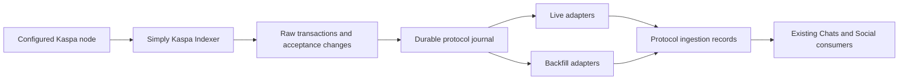

# Shared protocol ingestion

This candidate extends the Simply Kaspa ingestion approach already used by Social.
One configured Kaspa node feeds one Simply/PostgreSQL collector per network. Six
adapter families share the collector's durable journal, rather than opening a
chain scanner for every wallet application.



The private native Chats and signed Social/tip consumers are connected and
independently reviewed; remaining protocol extensions and public cutover are
still pending. Raw records
are **not** signature-validated posts, payments, notifications, or public APIs.
Existing public Chats/Social services remain on their current contracts. Full
six-family live/backfill acceptance is required before replacing their scanners.

## Protocol adapters

Each family has a `ScanAdapter` and `BackfillAdapter`, using the same byte parser.

| Family | Wire actions routed to its protocol parser |
| --- | --- |
| KaChat posts | `kchat:1:post`, `reply`, `quote`, `edit`, `delete`, `poll` |
| KaChat messages | `kchat:1:comm`, `dm`, `handshake`, `self_stash`, `gcomm`, `gctl`, `pay`, `payment`, `bcast`; legacy sealed `kchat` envelopes and `ciph_msg:1:bcast` |
| KaChat tips & co | `kchat:1:tip`, `vote`, `follow`, `block`, `broadcast`, `unquote`, `pollvote` |
| Kasia messages | `ciph_msg:1:comm`, `handshake`, `self_stash`, `gcomm`, `gctl`, `pay`, `payment`; legacy sealed envelopes |
| K-Social posts | `k:1:post`, `reply`, `quote` |
| K-Social co | `k:1:vote`, `follow`, `block`, `broadcast` |

`unvote`/`unfollow` are values inside their parent actions. `bcast` is a public
room; `broadcast` is a Social profile. An unknown action/version is retained for
future recovery but does not fall through to a generic Chat notification.
Recognition does not enable new room/group/poll/edit UI or bypass protocol
validation. Historical KaPosts using `k` keep that original wire root.

## Capture, replay and retention

Simply source is pinned to
`7b01229d8960f8f53f909ee0e69fb628053ac8ae` (the already-deployed v2.3.0), schema 23. The CLI checks its private
metrics for source revision and configured network, plus
required input/output/payload fields. It rejects self-send filtering, upstream
pruning, and enabled unused chain-wide tables. Database network binding is
immutable; DEV and PROD use separate databases and configured node endpoints.
Upstream emits a seven-character commit ID; `SOURCE.lock` records the full Git
revision and the tested immutable image behind that short metadata.
Upstream censors its database/RPC URLs. `bind-source.py` verifies the running
collector image, command, project, private network and SQL container, then records
the actual PostgreSQL system identifier and database OID in a read-only binding.
The adapter checks that binding against its real SQL connection before any work.
This prevents another database with the same logical name from passing as the
configured source. The receipt contains no credentials; the adapter receives its SQL credential
through `PROTOCOL_DATABASE_URL` and has no Docker socket. Regenerate the binding and recreate adapter containers after changing
source containers. Do not log unredacted Docker inspection/configuration.

Source triggers queue raw-body and acceptance changes in their originating
transactions. Unknown-body acceptance wakeups are necessary: Simply writes
bodies and acceptances concurrently. The worker bulk-cleans ordinary chain
wakeups once their non-protocol bodies arrive. It retains raw bytes, outputs,
input outpoints/resolved scripts, block metadata and acceptance changes for
protocol transactions. Binary encrypted tails are never coerced into UTF-8.

Scan delivery uses transactional acknowledgements, not `MAX(event_id)`: sequence
numbers can commit out of order. Per-transaction revision guards prevent stale
backfill from resurrecting rejected content. Scan and backfill write the same
ingestion record. Backfill never acknowledges live events or creates pushes.
The activation timestamp suppresses historical notification eligibility; a
transaction's reacceptance never creates a second first-acceptance eligibility.
Downstream consumers must retain eligible events while sender resolution or
signature/payment validation is pending, and re-read the latest canonical
acceptance before emitting a notification.

Use the owned `prune` command for raw working-set retention. It retains protocol
acceptance rows after deleting raw bodies, so later VCP revocation still reaches
the journal. Uncaptured protocol bodies are never pruned. Plain transfers,
including `payload=NULL`, expire without being stored in the protocol journal.
Journal/history/event retention and archival import are separate migration work;
do not infer that re-scanning a pruned node recovers old messages/posts.

Simply schema 23 does not preserve the script public key **version** separately.
It preserves the raw script and decoded address. A consumer needing an explicit
version must obtain/retain transaction proof from the node/archive before
claiming verified payment; routing or signed memo text is not payment evidence.

## Local checks

```sh
uv sync --locked
uv run python -m unittest discover -s tests -v
```

The PostgreSQL suite requires `PROTOCOL_TEST_DATABASE_URL` pointing to an empty
disposable database whose name starts with `protocol_test_`. It recreates that
test database's schemas. Without it, only pure routing/source-contract checks
run; skipped database tests are not acceptance evidence.

The copied schema fixture is from the pinned Simply source, under the adjacent
`tests/SIMPLY-LICENSE`. Protocol references are the existing K-Social pin
`917863f49623aa6802e5ad4c0e246581470d93cb` and KaChat indexer
`e2f462171bee80ff26c6fe14ddafe06614f05efa`. No upstream protocol implementation
has been copied into this routing layer.

## Private candidate

`compose.candidate.yaml` has no public ports or API routes and uses an isolated
candidate volume. Supply `PROTOCOL_ENV`, `PROTOCOL_NETWORK`, `KASPA_NODE_URL`,
`PROTOCOL_DB_PASSWORD` and tested immutable `PROTOCOL_CHAIN_IMAGE` and
`PROTOCOL_ADAPTER_IMAGE` in a private environment file. The Simply image must
report the reviewed source pin; a moving tag is not a release identity.

Build the adapter using `Dockerfile`, supplying an approved immutable Python
image through `PYTHON_IMAGE`. Dependencies are hash-locked in `requirements.txt`
and `uv.lock`. The runtime runs as UID 10001.

Start the private `database` and `indexer` services first. Then, from this
candidate's directory on the Docker host, generate its binding:

```sh
python3 bind-source.py --project "protocol_indexer_${PROTOCOL_ENV}" --network "$PROTOCOL_NETWORK"
```

The resulting `source-binding.json` contains no credentials, stays ignored by
Git, and is mounted read-only for `init` and `adapters`. Its parent task directory
must stay private. The source's PostgreSQL role needs permission to read
`pg_control_system()`; the candidate's existing database-owner role has it.

Commands inside the private adapter container:

```sh
python -m protocol_indexer.cli --network "$PROTOCOL_NETWORK" init
python -m protocol_indexer.cli --network "$PROTOCOL_NETWORK" worker
python -m protocol_indexer.cli --network "$PROTOCOL_NETWORK" backfill --family kachat_posts
python -m protocol_indexer.cli --network "$PROTOCOL_NETWORK" prune --retention-hours 24
```

`backfill --after` resumes the raw inventory by transaction ID. Late commits
below that cursor are handled by live delivery. This inventory replay does not
discover external archives; the archival adapter below supplies those receipts
through the same journal. Full historical coverage, remaining consumers and
live acceptance remain required before replacing either public scanner.

## External archival inventory

`archive_backfill.py` reuses the existing Social history collector's file-locked
rate buckets, retries, atomic gzip caches, SQLite progress, quarantines and bounded
workers. Its new inventory scope cannot reuse a K-only prepared verdict. Both
public Social discovery routes and explicit candidate IDs from existing Chats or
Social inventories lead through the same six-family byte dispatcher:

```sh
python3 archive_backfill.py verify "$ARCHIVE_INVENTORY" \
  --source "$DISCOVERY_SOURCE" --archive "$ARCHIVE_SOURCE" \
  --network "$PROTOCOL_NETWORK" --txid "$TRANSACTION_ID" --limit 1
python3 archive_backfill.py export "$ARCHIVE_INVENTORY" \
  --source "$DISCOVERY_SOURCE" --archive "$ARCHIVE_SOURCE" \
  --network "$PROTOCOL_NETWORK" --output "$NEW_BATCH_FILE"
```

Run it from the infrastructure tree, keeping the existing sibling history tools
present. No new dependencies or archive endpoint/network defaults are introduced.
`discover` uses the established public Social inventory traversal; private Chats
history still requires the existing address/indexer inventories to supply IDs.
This does not claim exhaustive discovery of messages or deleted Social actions.
Selected IDs resume quietly if already verified. Quarantines require explicit
`--retry-quarantine`; original failure evidence remains. Export refuses overwrite.

Every verification invocation checks the archive's **current** `/info/network`
`networkName`, distinguishing TN10 from TN11 even though their address prefixes
match. The verifier checks reported acceptance, exact full containing-block
membership/payload, every output amount/script/address, every input outpoint and
signature script. Receipts retain the full RPC transaction including output
script **versions**, plus the archive detail and acceptance identities. Binary
message tails remain raw hex. Archive consistency is not independent consensus,
Social signature validity, verified tipping or current acceptance reconciliation.

Export alone never mutates a service. Canonical import below reconciles latest
live acceptance/revocation; consumers must still validate signatures/payments.
Historical receipt `notify_allowed` is always false. Neither collector nor
importer broadcasts a transaction or emits a push. Routing alone does not
authorize a payment claim.

The journal config also has a persistent UUID `journal_id`, created once during
installation and retained across reinstalls and process/container restarts. Native
consumer batches carry it as `source_id`. A recreated journal gets a different
identity, so a receiver cannot silently treat reset revision numbers as old work.
The additive upgrade preserves existing config activation and captured history;
consumer migration must reconcile identity changes instead of overriding them.

## External history into the shared journal

`import_archive.py` requires the reviewed opt-in Simply source variant. Baseline
bindings and forged capabilities are rejected before opening the cache or
requesting archive data. The host binder checks the exact image, revision/patch
labels, source lock and active opt-in environment. Both live block-removal and
live-over-archive insertion capabilities are required.

`simply-journal.patch` preserves default upstream SQL. With
`KASANOVA_ACCEPTED_CHAIN_JOURNAL=true`, the same scanner calls owned SQL functions
for its existing insertion/removal operations. Removal records survive even
when no transaction existed. Import and removal lock the same block record;
import checks fresh archive acceptance after locking its sentinel, so later
live removals queue a revocation. A tuple flag marks archive sentinels: the first
genuine live insertion replaces one after waiting; ordinary live conflicts
retain upstream DO NOTHING behavior. Existing source bodies, canonical revisions
and pending revocations take precedence. Imports never create raw transaction
rows or reset source checkpoints.

Initialize the additive schema using the baseline source before activating the
hooked image. Then regenerate the read-only binding and recreate adapter mounts.
Never import against a baseline or unreviewed image. The base revision remains
in SOURCE.lock; the reviewed variant has its own exact patch/image identity.
Run from the infrastructure tree, or use the connector image with this script
as its Python entrypoint:

```sh
python3 import_archive.py --network "$PROTOCOL_NETWORK" \
  --archive "$ARCHIVE_SOURCE" --cache "$ARCHIVE_DELIVERY_CACHE" \
  --batch "$IMMUTABLE_EXPORTED_BATCH" --limit 500 --after-line 0
```

`next_after_line` acknowledges durable staging, including deferred records.
Reuse it for the next page of the same batch. PostgreSQL retains the receipt,
batch hash, line and retry time. Each invocation also drains ready jobs for that
batch, even at EOF. Exit2 and `pending>0` require retries; `end_of_batch=true`
alone does not mean delivery completed. Canonical writes, queue acknowledgement
and historical notification suppression share one transaction. Storage failures
remain operational failures.

The importer reuses existing HTTP tools with one attempt, a 10s socket timeout,
nonblocking rate locks, at most2s pacing wait, an8MiB response bound and a **12s
total POSIX request deadline**, including slow streams and redirects. Its
standalone worker owns/disarms/restores the alarm. Other collectors retain their
default retry policy. Pre-activation history still depends on trusted archive
evidence; this is not independent consensus or Social signature verification.
Full signature/payment consumer coverage and six-family live/backfill acceptance
remain required before replacing any public scanner.

## Private native Chats connector

The canonical journal now queues one durable `native-chats-v1` wakeup per
transaction. The live writer and inventory backfill enqueue identically. This
projection currently covers established Kasia/KaChat private actions and KaChat
tips; DM/inbox and room broadcasts remain retained in the raw journal pending
their established consumer adapters. The independent native Social consumer
handles supported signed public actions and verified tips.

`chats_worker.py` reuses the history HTTP/cache tooling. Missing evidence is
retried per job without acknowledging it. Verified immutable receipts and headers
are revalidated on reuse; incomplete/malformed responses are never cached as
successful proofs. Malformed cached entries are retained in quarantine and
refetched. All new cache writes obey the existing 2 GiB free-space pause.
The resolver checks exact network, every output, the precise input0 prior output
and source-node script/amount/address, then sends the latest canonical acceptance
to the existing private native `/history-import` route. Archive acceptance never
overwrites a current journal revocation. SQL/storage failures remain visible.

The native consumer binds persistent journal UUID + network and acknowledges
only after durable native storage. The connector deletes a job only after a
valid full acknowledgement and a final locked revision comparison. A source
revision changing during HTTP remains queued; no canonical lock spans HTTP I/O.
Stale/malformed/error/redirect responses retain the job. Historical delivery does
not emit push notifications.

Build `Dockerfile.chats` from the **hertz** context and freeze both image IDs.
`compose.chats.yaml` is an opt-in private overlay for `compose.candidate.yaml`;
it creates separate Chats and evidence volumes and publishes no ports/routes.
Supply the same configured node/full network, compatible native `CHATS_NETWORK_TYPE`,
HTTPS archive origin and a private bearer secret in the server's mode-0600 env.
Never print `compose config` with those values or reuse synthetic acceptance
volumes. Initialize the additive SQL schema and replay the supported raw
families before starting the connector. Existing public services keep their
writers and volumes until full six-family live/backfill acceptance and cutover.

## Public tip output evidence

Both live capture and inventory replay also enqueue `output-evidence-v1` for
`kchat:1:tip`. `evidence_worker.py` acquires immutable full output receipts using
the existing archive resolver and importer bounds (one attempt, 10s socket,
12s total deadline, 8MiB, shared nonblocking rate buckets and capacity pause).
It validates the configured source before cache/HTTP access, binds the journal
UUID and network, and rechecks them before each job. It does not scan the chain,
write canonical acceptance, decrypt tips or emit notifications.

Archive work requires the existing native SDK consumer's exact-revision
`verified_tip_output_pending:<revision>` queue state. Native publishes that
state only after verifying the tip signature and its accepted parent/author,
then rolls back incomplete projection work. Unknown or stale admission defers;
exact terminal native decisions (including wrong targets/authors) acknowledge
without HTTP. Prefix routing alone never admits an archive lookup. Native can
requeue proof work after parent reacceptance through the same durable queue.

Output proofs bind the exact transaction/payload and every indexed output's
amount/script to the canonical source, preserving full RPC script versions.
They do not require funding-input address resolution or equality between the
fee payer and tip signer. Signature validity, target authorization and payment
sum are still checked by the existing native SDK consumer.

Archive I/O holds only the evidence job, allowing source revisions to advance.
The final canonical revision fence retains changed work; missing evidence defers
only that job for five seconds. Revoked/observed rows are acknowledged without
HTTP. Proof storage and its acknowledgement commit before waking the independent
Social job, preserving the native consumer's job-before-canonical lock order.
A crash between commit and wake leaves the existing native retry intact.

`compose.evidence.yaml` is an opt-in overlay on the candidate and Chats overlays.
It reuses the same immutable connector image and private bound evidence volume,
with its own exclusive worker lock, shared cache/rate/cooldown and no endpoint or
bearer token. Replay the supported inventory once when adding this consumer to
an existing journal; historical rows are not silently marked as new acceptance.
No public service or scanner is replaced by starting this private worker.
