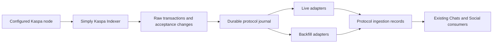

# Shared protocol ingestion

This candidate extends the Simply Kaspa ingestion approach already used by Social.
One configured Kaspa node feeds one Simply/PostgreSQL collector per network. Six
adapter families share the collector's durable journal, rather than opening a
chain scanner for every wallet application.



The final consumer connection in that diagram is pending integration. The code
currently captures and routes chain evidence into a private ingestion inbox;
these records are **not** signature-validated posts, payments, notifications, or
public APIs. Existing Chats/Social services remain running on their current
contracts. Do not replace them with this candidate yet.

## Protocol adapters

Each family has a `ScanAdapter` and `BackfillAdapter`, using the same byte parser.

| Family | Wire actions routed to its protocol parser |
| --- | --- |
| KaChat posts | `kchat:1:post`, `reply`, `quote`, `edit`, `delete`, `poll` |
| KaChat messages | `kchat:1:comm`, `dm`, `handshake`, `self_stash`, `gcomm`, `gctl`, `pay`, `payment`, `bcast`; legacy sealed `kchat` envelopes and `ciph_msg:1:bcast` |
| KaChat tips & co | `kchat:1:tip`, `vote`, `follow`, `block`, `broadcast`, `unquote`, `pollvote` |
| Kasia messages | `ciph_msg:1:comm`, `handshake`, `self_stash`, `gcomm`, `gctl`, `pay`, `payment`; legacy sealed envelopes |
| K-Social posts | `k:1:post`, `reply`, `quote` |
| K-Social co | `k:1:vote`, `follow`, `block`, `broadcast` |

`unvote`/`unfollow` are values inside their parent actions. `bcast` is a public
room; `broadcast` is a Social profile. An unknown action/version is retained for
future recovery but does not fall through to a generic Chat notification.
Recognition does not enable new room/group/poll/edit UI or bypass protocol
validation. Historical KaPosts using `k` keep that original wire root.

## Capture, replay and retention

Simply source is pinned to
`7b01229d8960f8f53f909ee0e69fb628053ac8ae` (the already-deployed v2.3.0), schema 23. The CLI checks its private
metrics for source revision and configured network, plus
required input/output/payload fields. It rejects self-send filtering, upstream
pruning, and enabled unused chain-wide tables. Database network binding is
immutable; DEV and PROD use separate databases and configured node endpoints.
Upstream emits a seven-character commit ID; `SOURCE.lock` records the full Git
revision and the tested immutable image behind that short metadata.
Upstream censors its database/RPC URLs. `bind-source.py` verifies the running
collector image, command, project, private network and SQL container, then records
the actual PostgreSQL system identifier and database OID in a read-only binding.
The adapter checks that binding against its real SQL connection before any work.
This prevents another database with the same logical name from passing as the
configured source. The receipt contains no credentials; the adapter receives its SQL credential
through `PROTOCOL_DATABASE_URL` and has no Docker socket. Regenerate the binding and recreate adapter containers after changing
source containers. Do not log unredacted Docker inspection/configuration.

Source triggers queue raw-body and acceptance changes in their originating
transactions. Unknown-body acceptance wakeups are necessary: Simply writes
bodies and acceptances concurrently. The worker bulk-cleans ordinary chain
wakeups once their non-protocol bodies arrive. It retains raw bytes, outputs,
input outpoints/resolved scripts, block metadata and acceptance changes for
protocol transactions. Binary encrypted tails are never coerced into UTF-8.

Scan delivery uses transactional acknowledgements, not `MAX(event_id)`: sequence
numbers can commit out of order. Per-transaction revision guards prevent stale
backfill from resurrecting rejected content. Scan and backfill write the same
ingestion record. Backfill never acknowledges live events or creates pushes.
The activation timestamp suppresses historical notification eligibility; a
transaction's reacceptance never creates a second first-acceptance eligibility.
Downstream consumers must retain eligible events while sender resolution or
signature/payment validation is pending, and re-read the latest canonical
acceptance before emitting a notification.

Use the owned `prune` command for raw working-set retention. It retains protocol
acceptance rows after deleting raw bodies, so later VCP revocation still reaches
the journal. Uncaptured protocol bodies are never pruned. Plain transfers,
including `payload=NULL`, expire without being stored in the protocol journal.
Journal/history/event retention and archival import are separate migration work;
do not infer that re-scanning a pruned node recovers old messages/posts.

Simply schema 23 does not preserve the script public key **version** separately.
It preserves the raw script and decoded address. A consumer needing an explicit
version must obtain/retain transaction proof from the node/archive before
claiming verified payment; routing or signed memo text is not payment evidence.

## Local checks

```sh
uv sync --locked
uv run python -m unittest discover -s tests -v
```

The PostgreSQL suite requires `PROTOCOL_TEST_DATABASE_URL` pointing to an empty
disposable database whose name starts with `protocol_test_`. It recreates that
test database's schemas. Without it, only pure routing/source-contract checks
run; skipped database tests are not acceptance evidence.

The copied schema fixture is from the pinned Simply source, under the adjacent
`tests/SIMPLY-LICENSE`. Protocol references are the existing K-Social pin
`917863f49623aa6802e5ad4c0e246581470d93cb` and KaChat indexer
`e2f462171bee80ff26c6fe14ddafe06614f05efa`. No upstream protocol implementation
has been copied into this routing layer.

## Private candidate

`compose.candidate.yaml` has no public ports or API routes and uses an isolated
candidate volume. Supply `PROTOCOL_ENV`, `PROTOCOL_NETWORK`, `KASPA_NODE_URL`,
`PROTOCOL_DB_PASSWORD` and tested immutable `PROTOCOL_CHAIN_IMAGE` and
`PROTOCOL_ADAPTER_IMAGE` in a private environment file. The Simply image must
report the reviewed source pin; a moving tag is not a release identity.

Build the adapter using `Dockerfile`, supplying an approved immutable Python
image through `PYTHON_IMAGE`. Dependencies are hash-locked in `requirements.txt`
and `uv.lock`. The runtime runs as UID 10001.

Start the private `database` and `indexer` services first. Then, from this
candidate's directory on the Docker host, generate its binding:

```sh
python3 bind-source.py --project "protocol_indexer_${PROTOCOL_ENV}" --network "$PROTOCOL_NETWORK"
```

The resulting `source-binding.json` contains no credentials, stays ignored by
Git, and is mounted read-only for `init` and `adapters`. Its parent task directory
must stay private. The source's PostgreSQL role needs permission to read
`pg_control_system()`; the candidate's existing database-owner role has it.

Commands inside the private adapter container:

```sh
python -m protocol_indexer.cli --network "$PROTOCOL_NETWORK" init
python -m protocol_indexer.cli --network "$PROTOCOL_NETWORK" worker
python -m protocol_indexer.cli --network "$PROTOCOL_NETWORK" backfill --family kachat_posts
python -m protocol_indexer.cli --network "$PROTOCOL_NETWORK" prune --retention-hours 24
```

`backfill --after` resumes the raw inventory by transaction ID. Late commits
below that cursor are handled by live delivery. This inventory replay does not
yet discover/import external historical archives; existing history tools and
verified archive receipts need to be connected before #5 is complete. Candidate
Docker/real-node execution, archival import, existing consumer cutover and live
acceptance remain required before replacing either current scanner.
